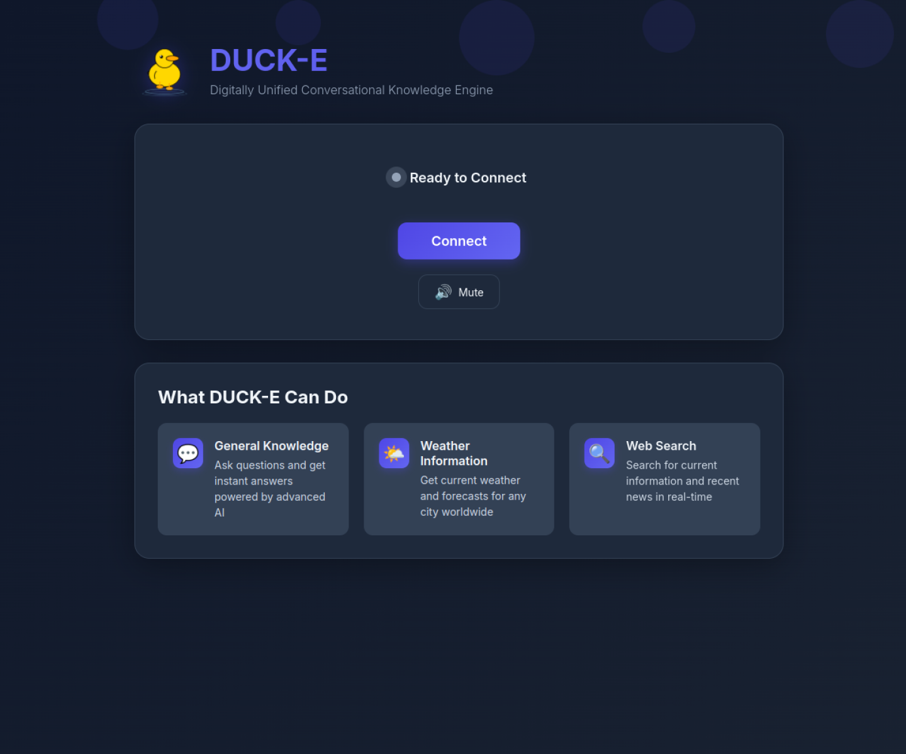

# DUCK-E

**DUCK-E** (Digitally Unified Conversational Knowledge Engine) is a browser-based voice assistant for rubber-duck debugging: you explain a problem out loud and it answers, asks questions, and can look things up. It is a FastAPI service that brokers a WebRTC session between the browser and the OpenAI Realtime API, plus a small set of server-side tools (weather, web search, URL fetch, per-user memory, voice switching). The backend is a custom `RealtimeSession` class; an earlier AG2/AutoGen dependency was removed and only the `ag2.init` client message name remains for compatibility.

**Live demo:** [ducke-demo.ardenone.com](https://ducke-demo.ardenone.com)



## How it works

```
Browser (WebRTC) → WebSocket → FastAPI → OpenAI Realtime API
                                              (gpt-realtime-2)
```

1. Your browser captures audio via the MediaDevices API and opens a WebRTC peer connection.
2. The FastAPI backend requests an ephemeral key from OpenAI — your real API key never touches the browser.
3. Speech is transcribed by OpenAI Whisper-1; the Realtime API handles both understanding and voice response natively.
4. When DUCK-E needs external data (weather, web search), it calls the appropriate tool on the server and folds the result into its reply.

## Features

### Voice I/O
- Full-duplex voice conversation over WebRTC via the OpenAI Realtime API
- 11 voices (the Realtime API's set) — changeable mid-session via `session.update`, no reconnect
- Responses can be interrupted mid-sentence; the client finalizes the cut-off transcript
- Optional push-to-talk mode (hold a button or the spacebar) instead of an always-open microphone

### Tools
| Tool | What it does |
|------|-------------|
| `get_current_weather` | Current conditions via Open-Meteo (free, no key required) |
| `get_weather_forecast` | Multi-day forecast via Open-Meteo |
| `web_search` | Live web search via OpenAI's `gpt-4o-mini` + web_search_preview |
| `web_fetch` | Fetches and parses a URL (SSRF-protected; blocks private IPs) |
| `save_memory` / `recall_memories` | Stores and retrieves facts about the user |
| `change_voice` | Switches voice mid-session |

### Persistent memory
DUCK-E stores per-user facts with categories, confidence scores, and time decay, and surfaces them at the start of each session. Memory is keyed by user identity via:
- **Validated JWTs** (including Google OAuth): Signed identity claims take precedence and memory is keyed to the JWT email or subject
- **Reverse proxy headers**: `x-forwarded-email` then `x-forwarded-user` is used only when the socket peer matches an IP or CIDR in `TRUSTED_PROXY_SOURCES`. The proxy must strip client-supplied identity headers before setting authenticated values.

Memory is silently disabled in local dev when neither authentication method is available.

### Cost protection
- Per-session spend cap (default: $5)
- Hourly spend cap (default: $50)
- Circuit-breaker threshold (default: $100 — disables new sessions for 30 minutes)
- Maximum session duration (default: 30 minutes)
- Client-side live cost display derived from token counts in `response.done` events

### Security
- Ephemeral key flow — the real API key is never sent to the browser
- Per-IP rate limiting via slowapi
- SSRF protection on `web_fetch` (resolves hostnames, rejects private/loopback ranges)
- Input validation via Pydantic models (`LocationInput`, `SearchQuery`, `FetchUrl`)
- CORS origin whitelist
- Security headers middleware (HSTS, CSP, X-Frame-Options, etc.)

## Before you start

- **An `OPENAI_API_KEY` with [Realtime API access](https://platform.openai.com/docs/guides/realtime).** DUCK-E cannot hold a conversation without one. Voice sessions are billed by OpenAI; the per-session and per-hour cost caps described below are enforced server-side, but usage still costs real money.
- **Docker with the Compose plugin**, or **Python 3.12** if you prefer running directly on the host.
- **A browser with a microphone** (Chrome, Edge, or Firefox) and permission to use it. Microphone access is only granted on secure origins — `http://localhost` counts as one, so local use needs no TLS.

## Quick start

### Docker Compose (builds locally)

```bash
git clone https://github.com/jedarden/duck-e.git && cd duck-e
cp .env.example .env
# Add OPENAI_API_KEY to .env, then:
docker compose up --build -d
```

The compose file publishes host port 8000 by default; set `DUCKE_PORT` to override it (e.g. `DUCKE_PORT=8080 docker compose up -d`).

`curl http://localhost:8000/status` returns the running message and version.
`curl http://localhost:8000/health/openai` returns `status: ok` with a valid
key, or `status: error` without one.

Check that it came up:

```bash
curl http://localhost:8000/status
# {"message":"WebRTC DUCK-E Server is running!","version":"0.2.141"}

curl http://localhost:8000/health/openai
# {"status":"ok",...}  — your key works
# {"status":"error",...} — the key is missing or rejected; fix .env and restart
```

Then open `http://localhost:8000`, allow the microphone when the browser prompts, and start talking.

### Local development

Requires Python 3.12.

```bash
git clone https://github.com/jedarden/duck-e.git && cd duck-e
python3.12 -m venv .venv
source .venv/bin/activate
pip install -r requirements.txt
cp .env.example .env
# Add OPENAI_API_KEY to .env, then (--env-file loads it):
uvicorn app.main:app --reload --host 0.0.0.0 --port 8000 --no-proxy-headers --env-file .env
```

## Environment variables

| Variable | Required | Default | Description |
|----------|----------|---------|-------------|
| `OPENAI_API_KEY` | Yes | — | Must have Realtime API access |
| `REALTIME_MODEL` | No | `gpt-realtime-2` | Override the realtime model |
| `GOOGLE_CLIENT_ID` | No | — | Google OAuth client ID (for user authentication) |
| `GOOGLE_CLIENT_SECRET` | No | — | Google OAuth client secret |
| `GOOGLE_REDIRECT_URI` | No | `http://localhost:8000/auth/callback` | OAuth callback URL |
| `JWT_SECRET_KEY` | No | `your-secret-key-here-change-in-production` | JWT signing secret |
| `JWT_ALGORITHM` | No | `HS256` | JWT algorithm |
| `JWT_EXPIRATION_MINUTES` | No | `120` | JWT token expiration time |
| `TRUSTED_PROXY_SOURCES` | No | empty (trust none) | Comma-separated proxy IP addresses or CIDRs permitted to supply `x-forwarded-user` and `x-forwarded-email` |
| `RATE_LIMIT_ENABLED` | No | `true` | Toggle per-IP rate limiting |
| `RATE_LIMIT_WEBSOCKET` | No | `5/minute` | Per-IP WebSocket connection rate |
| `COST_PROTECTION_ENABLED` | No | `true` | Toggle cost protection |
| `COST_PROTECTION_MAX_SESSION_COST_USD` | No | `5.0` | Per-session spend cap |
| `COST_PROTECTION_MAX_TOTAL_COST_PER_HOUR_USD` | No | `50.0` | Hourly spend cap |
| `COST_PROTECTION_CIRCUIT_BREAKER_THRESHOLD_USD` | No | `100.0` | Kill-switch threshold |
| `COST_PROTECTION_MAX_SESSION_DURATION_MINUTES` | No | `30` | Maximum session length |
| `ALLOWED_ORIGINS` | No | — | CORS origin whitelist (comma-separated) |
| `GRAFANA_ADMIN_USER` / `GRAFANA_ADMIN_PASSWORD` | No | — | Required operator credentials for the monitoring Compose stacks |

## API endpoints

| Method | Path | Description |
|--------|------|-------------|
| `GET` | `/` | Main chat UI |
| `WS` | `/session` | Real-time audio WebSocket |
| `GET` | `/status` | Health check + version |
| `GET` | `/health/openai` | Tests ephemeral key creation |
| `GET` | `/metrics` | Prometheus metrics |
| `GET` | `/auth/login` | Initiate Google OAuth flow |
| `GET` | `/auth/callback` | OAuth callback handler |
| `GET` | `/auth/config` | Check OAuth configuration |
| `GET` | `/auth/me` | Validate JWT and get user info |

## Voices

DUCK-E ships with 11 voices from the OpenAI Realtime API. Switch any time via the voice selector in the UI or by asking DUCK-E to change its voice mid-conversation:

`alloy` · `ash` · `ballad` · `coral` · `echo` · `fable` · `nova` · `onyx` · `sage` · `shimmer` · `verse`

## License

MIT — see [LICENSE](LICENSE).

---

Part of [jedarden.com](https://jedarden.com) · Read the write-up: [jedarden.com/projects/ducke/](https://jedarden.com/projects/ducke/)

*This GitHub repo is a read-only mirror of git.ardenone.com/jedarden/duck-e — issues and PRs are welcome here either way.*
